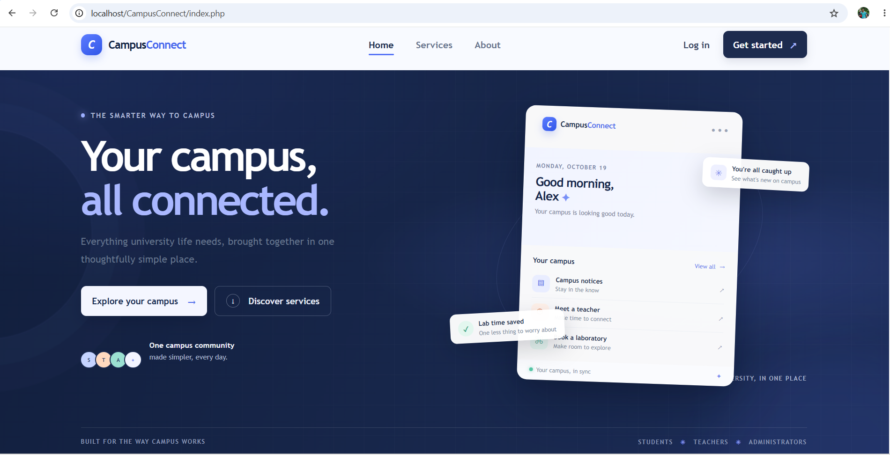
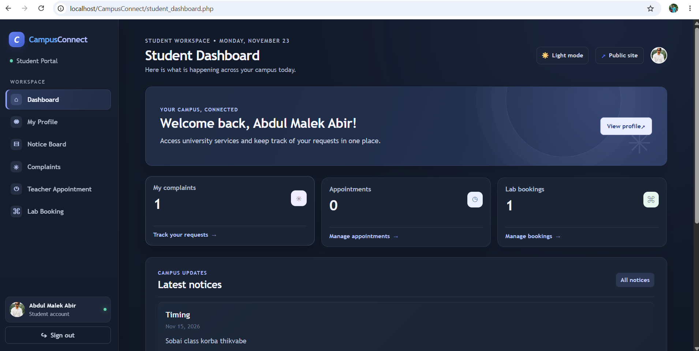
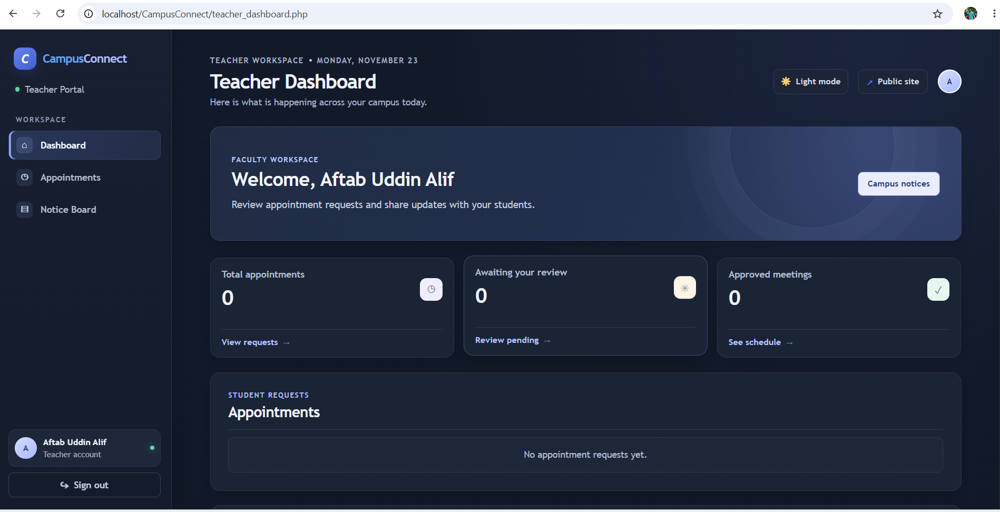
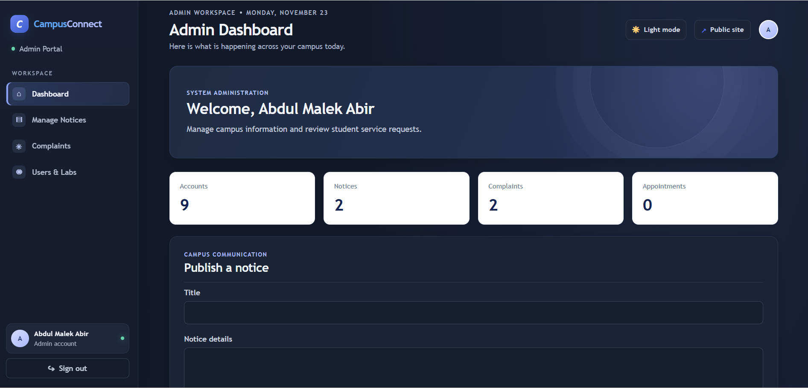
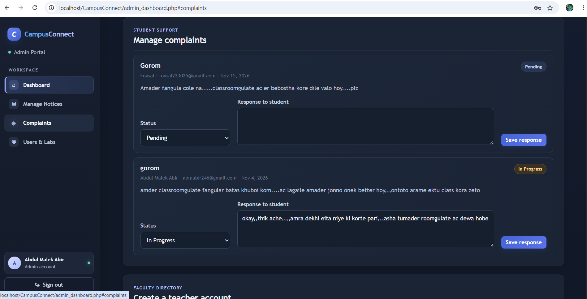

# 🎓 CampusConnect – Smart University Service Management System

A web-based university service management system designed to bring students, teachers, and administrators together on one platform.

## 📌 About the Project

CampusConnect is a web application developed to simplify common university services. It provides separate dashboards for Students, Teachers, and Administrators.

The system helps students access campus notices, submit complaints, request appointments with teachers, and book university laboratories.

## ✨ Key Features

### 👨‍🎓 Student
- Student Registration and Login
- Personal Profile Management
- View Campus Notices
- Submit and Track Complaints
- Request Teacher Appointments
- Request Laboratory Bookings

### 👨‍🏫 Teacher
- Teacher Dashboard
- View Student Appointment Requests
- Approve or Reject Appointments
- Mark Appointments as Completed
- View Campus Notices

### 🛡️ Administrator
- Admin Dashboard
- Publish and Manage Notices
- Manage Student Complaints
- Create Teacher Accounts
- Add and Manage Laboratories
- Approve or Reject Lab Bookings
- View User Directory

## 🛠️ Technologies Used

| Technology | Purpose |
|---|---|
| HTML | Website Structure |
| CSS | Website Design |
| JavaScript | Client-side Interaction |
| PHP | Backend Development |
| MySQL | Database Management |
| XAMPP | Local Development Server |

## ⚙️ Installation & Setup

### Requirements
- XAMPP
- Web Browser
- Git (optional)

### Steps

1. Clone or download this repository.
2. Copy the project folder into `C:\xampp\htdocs\`.
3. Start Apache and MySQL from XAMPP Control Panel.
4. Open phpMyAdmin: `http://localhost/phpmyadmin/`
5. Create a database named `campusconnect_db`.
6. Import the provided `database.sql` file.
7. Open your browser and visit:

   `http://localhost/CampusConnect/`

## 🔐 Security Features

- Password Hashing
- Prepared SQL Statements
- Session-based Authentication
- Role-based Access Control
- CSRF Token Verification

## 📁 Project Structure

```text
CampusConnect/
├── css/
├── js/
├── includes/
├── uploads/
├── database.sql
├── index.php
├── login.php
├── register.php
├── student_dashboard.php
├── teacher_dashboard.php
└── admin_dashboard.php
```

## 🎯 Project Objective

The main objective of CampusConnect is to make university services more organized, accessible, and efficient through a centralized web-based platform.

## 👨‍💻 Project Information

**Project Name:** CampusConnect  
**Project Type:** University Academic Project  
**Course:** System Analysis and Design (Sessional)  
**Department:** Computer Science and Engineering  
**Institution:** CCN University of Science and Technology

---

*Developed as an academic project to simplify university service management.*

## 📸 Project Screenshots

### 🏠 Homepage


### 👨‍🎓 Student Dashboard


### 👨‍🏫 Teacher Dashboard


### 🛡️ Admin Dashboard


### 📝 Complaint Management

